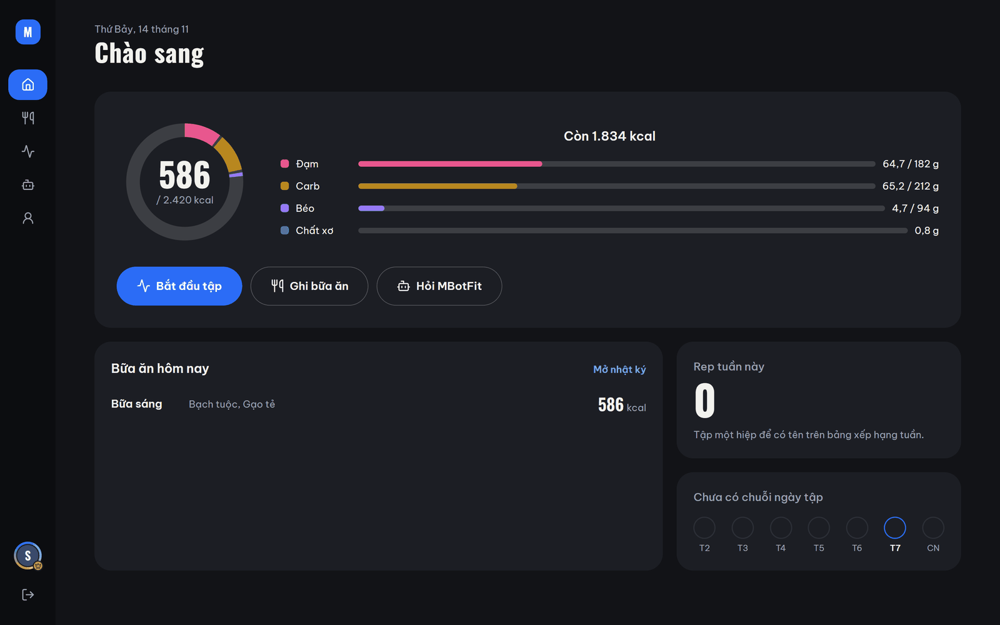
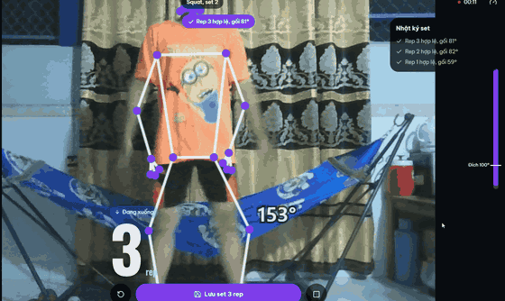
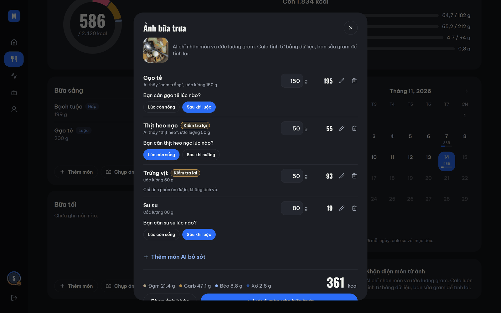
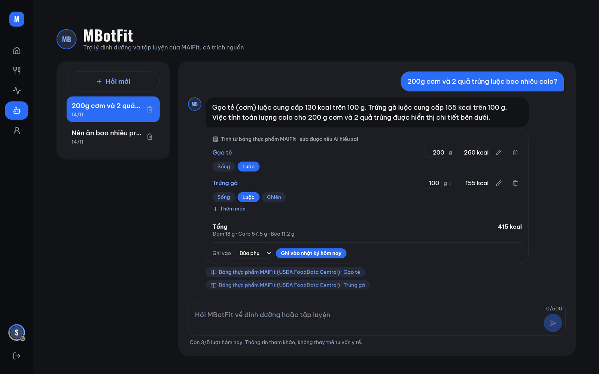
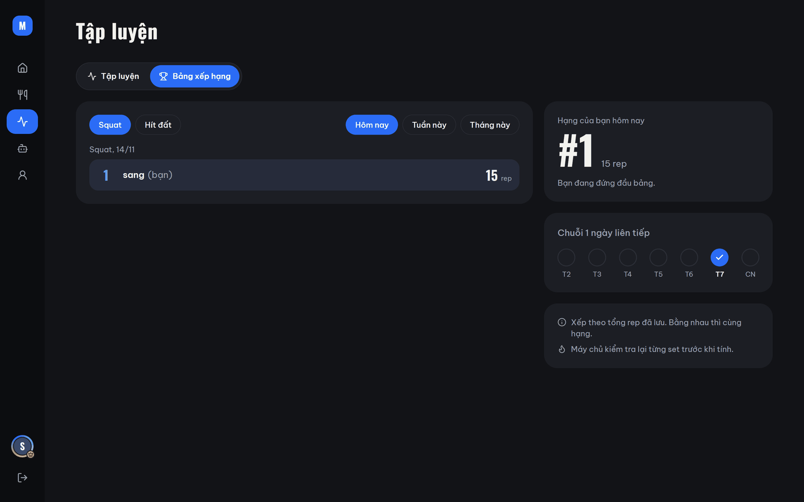
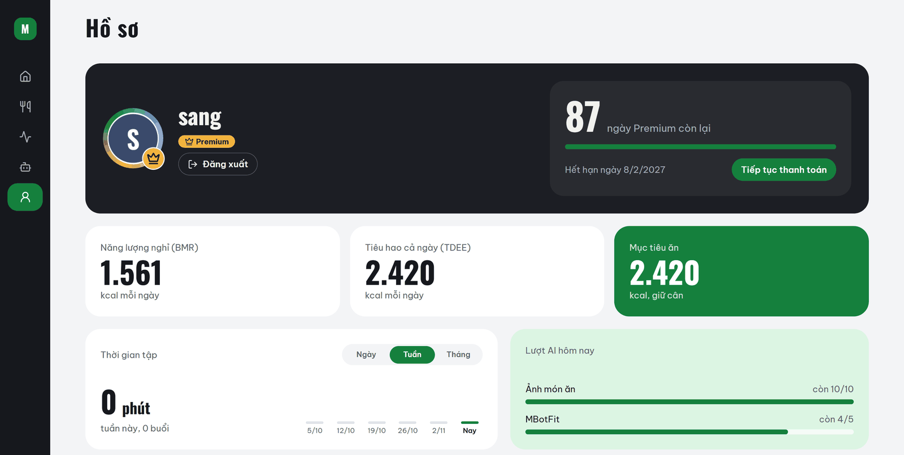

<h1 align="center">MAIFit</h1>

<p align="center">
  A fitness web app that counts your reps with the camera, logs meal calories from a photo,
  and answers nutrition questions with cited sources.
</p>

<p align="center">
  <a href="https://maifit.gnaspham1218.dev"><strong>Live demo</strong></a> ·
  <a href="docs/getting-started.md">Run it locally</a> ·
  <a href="docs/architecture.md">Architecture</a>
</p>

<p align="center">
  
</p>

## Features

| | |
|---|---|
|  | **Rep counter.** Pick squat or push-up and start. MediaPipe Pose runs in the browser and counts reps from joint angles; no video leaves the device. Every attempt is logged, with the reason when one does not count. |
|  | **Calories from a photo.** The AI names the foods and estimates grams. Calories and macros are computed by code from 300+ USDA FoodData Central items, and every gram value can be corrected. |
|  | **MBotFit, a cited chatbot.** Answers come only from retrieved sources (sports nutrition position stands and the food table), with citations. Medical questions are refused before any model call. |
|  | **Leaderboards and streaks.** Daily, weekly and monthly rankings per exercise, in Vietnam time. |
|  | **Profile.** TDEE and calorie target, weight history, training time by day, week and month, light and dark themes, and a personal accent color. |

<sub>P.S. That's my lil bro in the rep counter demo :D</sub>

## Tech stack

**Frontend:** React 19, TypeScript, Vite, Tailwind CSS 4, MediaPipe Pose
**Backend:** Java 25, Spring Boot 4, Spring Security (JWT), Spring Data JPA, Spring AI, Flyway
**Data and AI:** PostgreSQL 17 + pgvector, Google Gemini, Ollama (`bge-m3` embeddings)
**Infrastructure:** Docker Compose on a VPS, Nginx, GitHub Actions, GitHub Container Registry

## Engineering highlights

- **The AI never computes a number the user relies on.** Vision and chat models only name foods and amounts; calories always come from a cited dataset, so a wrong guess is visible and fixable. → [ADR 001](docs/decisions/001-ai-never-computes-calories.md)
- **Privacy by design.** Pose detection runs on the device; the server only receives the rep count and re-checks it.
- **Measured AI cost.** Every model call records its token usage, and per-user daily limits keep the bill bounded.
- **Defense in depth.** Mozilla HTTP Observatory **A+**, strict CSP without `unsafe-inline`, rate limits per IP and per account, Trivy image scanning as a deploy gate, CodeQL and Dependabot.
- **Automated delivery.** Every merge to `main` is built, scanned, pushed to GHCR and deployed by GitHub Actions; the server only pulls images.

## Documentation

Start with the [documentation index](docs/README.md).

| Document | Contents |
|---|---|
| [Getting started](docs/getting-started.md) | Requirements, environment variables, running locally, tests |
| [Architecture](docs/architecture.md) | System overview, request flow, code structure, data model |
| [Modules](docs/modules/) | How each feature works, its flow and its limits |
| [Decisions](docs/decisions/) | Why the main technical choices were made, and what they cost |
| [Deployment](docs/deployment.md) | CI/CD pipeline, server setup, operations |
| [Security](docs/security.md) | Threats considered and how each is handled |
| [Roadmap](docs/roadmap.md) | Planned work and known limitations |

## Quick start

```bash
cp .env.example .env            # fill in the values
docker compose up -d            # PostgreSQL + pgvector
cd backend && ./mvnw spring-boot:run
cd frontend && npm install && npm run dev
```

The full setup, including the chatbot sources and API keys, is in [Getting started](docs/getting-started.md).

## Data sources

- Food composition: [USDA FoodData Central](https://fdc.nal.usda.gov), SR Legacy and Foundation Foods (CC0).
- Chatbot sources: position stands and reviews of the International Society of Sports Nutrition (ISSN).

MAIFit gives general information and does not replace medical advice.
