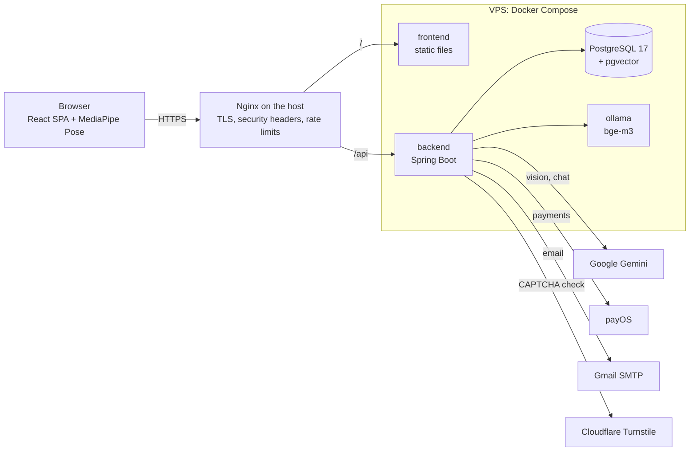
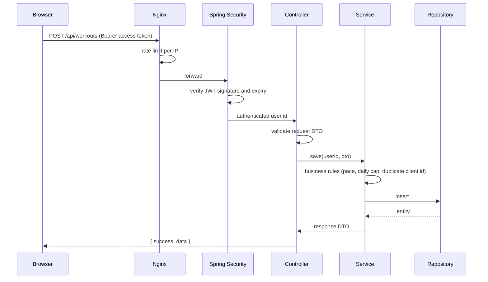
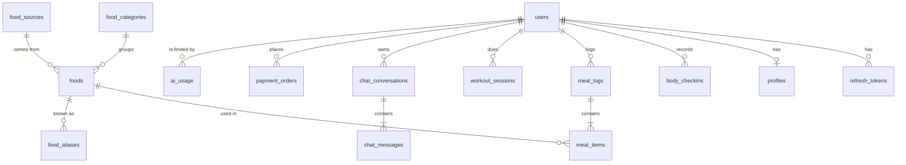

<sub>[MAIFit](../README.md) / [Docs](README.md) / Architecture</sub>

# Architecture

## System overview



- **One VPS, four containers** ([Deployment](deployment.md)). Nginx runs on the host and terminates TLS. Containers bind to `127.0.0.1` or to the internal Docker network only; the firewall allows ports 22, 80 and 443 and nothing else.
- **One database for everything** ([ADR 005](decisions/005-postgres-pgvector.md)). Business data and embeddings share one PostgreSQL instance with the pgvector extension, so a chatbot answer and the food rows it cites are read in the same database.
- **AI is split by job** ([ADR 003](decisions/003-self-hosted-embeddings.md)). Gemini is used where a large model is needed (recognizing foods in a photo, writing an answer). Embeddings run on a self-hosted Ollama container: free per question, and the question never leaves the server during retrieval.
- **Heavy client-side work.** Pose detection and rep counting run in the browser ([ADR 002](decisions/002-rep-counting-in-browser.md)). The server only stores the result and checks that it is plausible.

## Request flow

A typical authenticated call, for example saving a workout set:



Every response uses one envelope (`success`, `code`, `message`, `data`). Errors carry a stable `code` such as `AI_DAILY_LIMIT`, and the frontend maps each code to a Vietnamese message.

## Authentication

- **Access token:** a JWT signed with HS256, valid for 15 minutes, kept in memory by the frontend (never in `localStorage`).
- **Refresh token:** random, valid for 7 days, sent only as an `HttpOnly`, `Secure`, `SameSite=Strict` cookie. The database stores its SHA-256 hash, never the token.
- **Rotation with reuse detection:** each refresh issues a new token and revokes the old one. Presenting a revoked token is treated as theft: every session of that user is revoked and they must sign in again. Only one refresh runs at a time in the frontend, so parallel 401s do not trigger a false alarm.
- On page load the app calls `/api/auth/refresh` to get a new access token; a `401` on any call triggers one refresh and a retry.

Details: [modules/auth.md](modules/auth.md).

## Code structure

### Backend (`backend/src/main/java/.../backend`)

Organized **by feature**, each with the same layers. Each feature is described in [Modules](modules/README.md):

```
auth/      register, login, email verification, password reset, tokens
user/      account, Premium status, accent color
profile/   body data and TDEE
body/      weight check-ins
food/      food table, search, food requests
meal/      meal logs and items, nutrition math
ai/        Gemini vision, daily AI quota, token usage
workout/   sessions, leaderboard, streak, training time
chat/      RAG chatbot: ingest, retrieval, answer, history, evaluation
payment/   Premium checkout, payOS provider, webhook
common/    API envelope, exceptions, email, time zone, security helpers
config/    typed configuration properties and Spring configuration
```

Inside a feature: `controller` (HTTP, validation) → `service` (business rules, transactions) → `repository` (Spring Data JPA, native SQL where needed) with `entity`, `dto` and `mapper`. Controllers never return entities.

### Frontend (`frontend/src`)

```
pages/        one component per route
components/   UI pieces, grouped by feature (chat/, workout/, profile/, premium/, ...)
hooks/        data and state logic shared by pages (usePremiumCheckout, useWorkoutHistory, ...)
apis/         one module per backend feature, all through apis/client.ts
exercises/    squat and push-up definitions (joints, angle thresholds)
utils/        pure functions with unit tests (rep counter, nutrition, time summaries)
providers/    auth context
layouts/      app shell (sidebar, bottom bar) and auth layout
```

Logic that can be pure (the rep counter state machine, nutrition math, time summaries) lives in `utils/` without React, so it is unit-tested directly.

## Data model

Main tables, grouped by feature. The schema is owned by Flyway migrations in `backend/src/main/resources/db/migration`.



Conventions:

- `BIGINT` identity keys; every query on user data filters by the authenticated user (no access by id alone).
- Enumerations are `VARCHAR` with a `CHECK` constraint, mapped with `@Enumerated(EnumType.STRING)`.
- Nutrition values are stored per 100 g; meal totals are computed when read, never stored.
- Tokens are stored only as hashes.
- `vector_store` (pgvector, 1024 dimensions, HNSW index) holds the chatbot chunks with their source in metadata.

## Configuration and secrets

- Typed `@ConfigurationProperties` classes in `config/`; defaults in `application.yaml`.
- Secrets come only from environment variables: `.env` locally, `deploy/.env` on the server, GitHub Secrets in CI. A missing required secret stops the application at startup instead of failing later.
- Feature limits (AI calls per day, meals per day, payment orders per day) are configuration, not code. See [Premium and AI quotas](modules/premium.md).

---
<!-- nav -->

**Related:** [Modules](modules/README.md) · [Decisions](decisions/README.md) · [Security](security.md) · [Deployment](deployment.md)

← [Getting started](getting-started.md) | [Modules](modules/README.md) →
