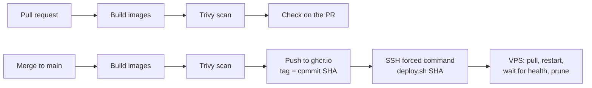

<sub>[MAIFit](../README.md) / [Docs](README.md) / Deployment</sub>

# Deployment

Production runs at https://maifit.gnaspham1218.dev on one VPS. → [ADR 004](decisions/004-single-vps-docker-compose.md), [ADR 007](decisions/007-build-in-ci-pull-on-server.md)

## Server

| | |
|---|---|
| Machine | 1 vCPU, 4 GB RAM, 30 GB disk, Ubuntu |
| Reverse proxy | Nginx on the host, Let's Encrypt certificate renewed by certbot |
| Containers | `frontend`, `backend`, `db` (PostgreSQL 17 + pgvector), `ollama` (bge-m3), all `restart: unless-stopped` |
| Firewall | ufw: only 22, 80, 443; fail2ban for SSH and repeated rate-limit hits |
| Access | SSH with keys only, no root login, no passwords |

Containers publish ports on `127.0.0.1` only (or none: Ollama is reachable only inside the Docker network). The database is reached from a laptop through an SSH tunnel.

Memory is capped per container (backend 768 MB, Ollama 1.5 GB) so one misbehaving service cannot starve the database.

## Pipeline



Workflow: `.github/workflows/deploy.yml`.

- Images are built once into the runner, scanned, and only then pushed, so the deployed image is the scanned image. A **critical** vulnerability with an available fix fails the job.
- Third-party actions are pinned by commit SHA where a tag has been hijacked in the past (Trivy).
- The deploy key on the server is restricted to `deploy.sh`, which accepts only a 40-character commit SHA.
- `deploy.sh` updates the compose file from `main`, sets `IMAGE_TAG`, pulls, runs `docker compose up -d`, waits up to 90 s for `/api/actuator/health`, then removes unused images older than 3 days. Logs are not printed in CI, because CI logs of a public repository are public.
- Database migrations run automatically when the new backend starts (Flyway). A failing migration stops the new backend; the deploy job reports it.

## Configuration

Secrets live in `deploy/.env` on the server (local equivalents in [Getting started](getting-started.md#1-clone-and-configure)) (never in the repository). The compose file uses `${VAR:?message}` for required values, so a missing secret stops the deploy **before** containers are replaced and the running version stays up. Template: [`deploy/.env.example`](../deploy/.env.example).

## Operations

### After the first deploy of the chatbot, or when sources change

See [how ingest works](modules/chatbot.md#ingest).

```bash
cd ~/maifit/deploy
C="docker compose -f docker-compose.prod.yml --env-file .env"
$C exec ollama ollama pull bge-m3
$C run --rm --no-deps -e SPRING_PROFILES_ACTIVE=ingest backend
```

### Roll back

```bash
~/bin/maifit-deploy <previous commit SHA>
```

Images from the last few days are still on the server; older ones are pulled again from ghcr.io. A rollback across a database migration needs a migration that undoes it.

### Back up the database

```bash
cd ~/maifit/deploy
docker compose -f docker-compose.prod.yml --env-file .env exec -T db \
  sh -c 'pg_dump -U "$POSTGRES_USER" -d "$POSTGRES_DB" -Fc' > ~/maifit-$(date +%F).dump
```

Restore with `pg_restore --clean --if-exists` inside the `db` container. Provider snapshots are taken before risky changes such as a server upgrade.

### Useful checks

```bash
$C ps                              # containers and health
$C logs --tail 100 backend         # recent backend logs (no user content is logged)
free -h && df -h /                 # memory and disk
sudo fail2ban-client status sshd   # banned SSH clients
```

---
<!-- nav -->

**Related:** [Getting started](getting-started.md) · [Security](security.md) · [ADR 004: One VPS with Docker Compose](decisions/004-single-vps-docker-compose.md) · [ADR 007: Build in CI, pull on the server](decisions/007-build-in-ci-pull-on-server.md)

← [ADR 007: Build in CI, pull on the server](decisions/007-build-in-ci-pull-on-server.md) | [Security](security.md) →
