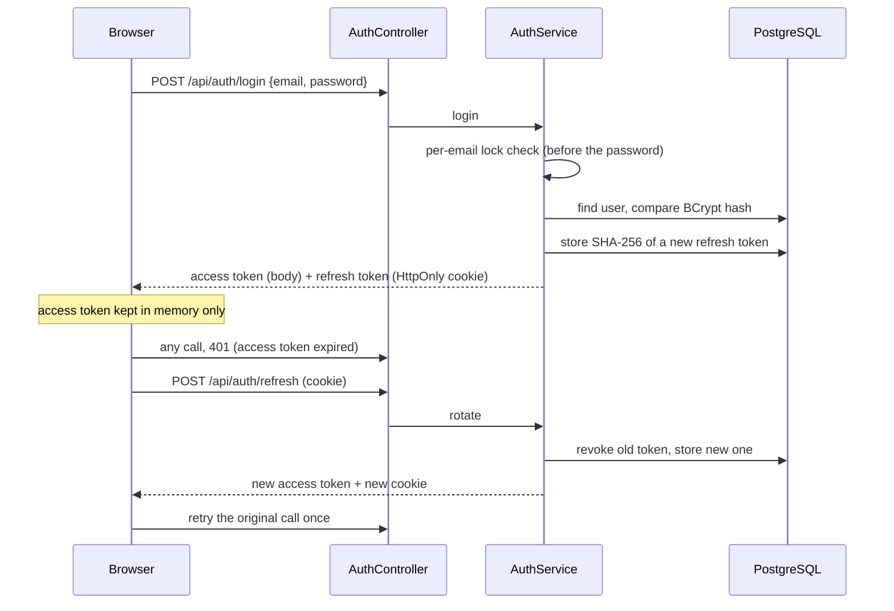

[MAIFit](../../README.md) / [Docs](../README.md) / [Modules](README.md) / Auth

# Auth

Accounts with email and password, email verification, password reset, and session management with JWT access tokens and rotating refresh tokens. Why tokens are stored this way: [ADR 006](../decisions/006-token-storage.md).

## Flow

### Sign in and stay signed in

### Register and verify

1. `POST /api/auth/register` with a Cloudflare Turnstile token. The token is verified on the server before anything else.
2. The user is created unverified; a verification token is generated, stored as a hash and emailed (24 h validity).
3. `POST /api/auth/verify-email` marks the account verified and consumes the token.

Password reset follows the same pattern: `forgot-password` (CAPTCHA, 30 min token) then `reset-password`, which also revokes every refresh token of the user.

## Main components

| Component | Role |
|---|---|
| `AuthController` | Endpoints under `/api/auth`; sets and clears the refresh cookie |
| `AuthService` | Register, login, refresh rotation, logout, verification, reset |
| `JwtService` | Issues and reads HS256 access tokens (15 min) |
| `TokenService` | Random tokens and their SHA-256 hashes |
| `AuthRateLimiter` | Per-email limits with Bucket4j token buckets in a size-bounded Caffeine cache |
| `TurnstileVerifier` | Server-side CAPTCHA check, fails closed |
| `EmailEventListener`, `EmailDailyQuota` | Sends mail after the transaction commits; global daily cap |
| `frontend/src/apis/client.ts` | Holds the access token, refreshes once on 401, never runs two refreshes in parallel |

## Endpoints

| Method | Path | Notes |
|---|---|---|
| POST | `/api/auth/register` | CAPTCHA required |
| POST | `/api/auth/verify-email` | |
| POST | `/api/auth/login` | Returns the access token, sets the refresh cookie |
| POST | `/api/auth/refresh` | Reads the cookie only, never the body |
| POST | `/api/auth/logout` | Revokes the token; never fails |
| POST | `/api/auth/forgot-password` | CAPTCHA required; same response whether the email exists or not |
| POST | `/api/auth/reset-password` | |
| GET | `/api/auth/me` | Current user |

## Data

- `users`: email (lower-case, unique), username, BCrypt `password_hash`, `email_verified`, `role`, `premium_until`, `accent_color`
- `refresh_tokens`: SHA-256 `token_hash`, `expires_at`, `revoked_at` (kept to detect reuse)
- `email_tokens`: SHA-256 `token_hash`, `type` (`VERIFY` / `RESET`), `expires_at`, `used_at`

## Security

- **Refresh token reuse:** a revoked token that comes back means it was stolen or replayed. Every session of that user is revoked.
- **Cookie:** `HttpOnly`, `Secure`, `SameSite=Strict`. JavaScript cannot read it.
- **Brute force:** 5 failed sign-ins per email per 15 minutes locks that email, checked before the password so a correct password does not bypass the lock. Unknown emails are counted too, so the lock does not reveal which emails exist. Nginx adds a per-IP limit on the same endpoints ([Security](../security.md)).
- **Enumeration:** login returns one error for a wrong email and a wrong password; `forgot-password` answers the same in every case and silently drops mail beyond 3 per email per hour.
- **Bots and mail abuse:** CAPTCHA on the two endpoints that send email, and a global cap of 300 emails per day (Vietnam time) protects the Gmail account from being suspended.
- **Fail fast:** a missing or short `JWT_SECRET`, or a missing CAPTCHA secret, stops the application at startup.

## Trade-offs and limits

- **In-memory rate limits.** Counters live in the backend process: correct for one instance, reset on restart. Several instances would need Redis. → [ADR 004](../decisions/004-single-vps-docker-compose.md)
- **`EMAIL_ALREADY_EXISTS` on register.** It reveals that an email is registered, accepted for a clearer sign-up; CAPTCHA and rate limits make bulk probing slow.
- **No CSRF token.** The API authenticates with a Bearer header that browsers never attach on their own; the only cookie is `SameSite=Strict` and used by two endpoints.
- **No social login yet.** Google sign-in is planned; see the [roadmap](../roadmap.md).

---
<!-- nav -->

**Related:** [Security](../security.md) · [ADR 006: Token storage](../decisions/006-token-storage.md) · [Architecture](../architecture.md)

← [Modules](README.md) | [Nutrition](nutrition.md) →
