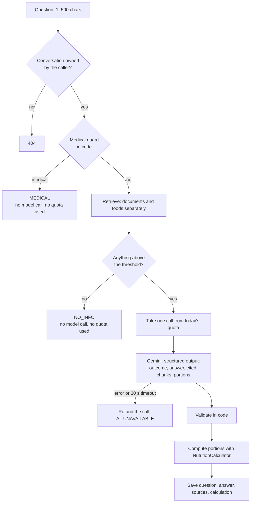

<sub>[MAIFit](../../README.md) / [Docs](../README.md) / [Modules](README.md) / MBotFit chatbot</sub>

# MBotFit chatbot

A nutrition and training assistant that answers only from retrieved sources, cites them, and leaves every calculation to code.

## Sources

- Five position stands and reviews of the International Society of Sports Nutrition (protein, creatine, nutrient timing, diets and body composition, sports nutrition review), CC BY 4.0, kept in English. Vietnamese questions still match them well with a multilingual embedding model.
- The [food table](nutrition.md#the-food-table): one chunk per food name with every preparation and alias, so a question about several foods is not filled by variants of one.
- Only sources whose license allows commercial use, because the app sells a Premium plan.

## Ingest

Runs as a Spring profile, never through an endpoint:

```bash
./mvnw spring-boot:run -Dspring-boot.run.profiles=ingest
```

`RagMarkdownParser` splits documents by heading; long sections are split again by tokens, with the heading path prefixed to each chunk. Chunks are embedded with `bge-m3` (Ollama, 1024 dimensions) and stored in `vector_store` (pgvector, HNSW, cosine). Re-running replaces the chunks of each source. → [ADR 003](../decisions/003-self-hosted-embeddings.md)

## Answering a question



- **Quota:** one call of the [daily limit](premium.md#daily-quota) per answered question; refusals in code are free.
- **Retrieval** (`ChatRetriever`): documents top 5 above 0.45; foods are found by exact name match in the question (accents, whole words, longest phrase first) plus semantic search above 0.60, merged up to 10 foods. Exact matching was added because a question listing five foods produces a "diluted" vector that found only three of them.
- **Prompt** (`ChatPromptBuilder`): rules in the system message; chunks wrapped in tags with `<` and `>` neutralized; the last 6 messages for context, but only the current question is embedded.
- **Validation** (`ModelAnswerValidator`): the outcome must be valid, every citation must point to a retrieved chunk, an answer must cite at least one, portions must point to food chunks with grams between 1 and 2,000. Invalid portions are dropped; the answer is kept.
- **Preparation** (`PreparationEvidence`): a cooking method chosen by the model is kept only if the question contains evidence for it. Otherwise the user picks it from chips. The model is never allowed to guess.
- **Calculation card:** portions are computed with the same `NutritionCalculator` as [meal logging](nutrition.md#logging-a-meal). The user can change foods, grams and preparations (`PUT /api/chat/messages/{id}/calculation`, no AI call) and add the result to today's meal log.

Outcomes: `ANSWERED`, `NO_INFO`, `MEDICAL`, `OUT_OF_SCOPE`. Refusals are normal responses; the frontend shows a fixed Vietnamese sentence for each.

## Guarding against off-topic use and prompt injection

The model is treated as untrusted: it has no tools, sees no secrets, and every decision that matters is checked by code.

1. Question length limit.
2. Medical questions refused in code, in both Vietnamese accent styles.
3. Retrieval gate in code: nothing relevant, no model call.
4. Instructions and data separated; data tags escaped.
5. Structured output, with citations and portions verified.
6. Source titles and links built from chunk metadata, never from the model's text.
7. The frontend renders answers as plain text and accepts only `http(s)` links.
8. Daily quota per plan and Nginx rate limits.
9. A fixed evaluation set re-run after every change.

## Evaluation

`backend/src/main/resources/chat-eval/cases.txt` lists questions with the expected outcome, the source section that must be cited, follow-up context and expected portions. The `chat-eval` profile runs them through the real logic and checks outcome, citations, portions, Vietnamese diacritics, no HTML, and that **the answer does not contain the calories computed by code** (the model must not do arithmetic). History: 10/15 → 15/15 (thinking level LOW) → 22/23 after adding foods.

## Endpoints

| Method | Path | Notes |
|---|---|---|
| POST | `/api/chat/messages` | Ask; returns answer, sources, calculation, remaining quota |
| PUT | `/api/chat/messages/{id}/calculation` | Edit the calculation card |
| GET | `/api/chat/quota` | Remaining questions today |
| GET | `/api/chat/conversations` | Latest 50 conversations |
| GET | `/api/chat/conversations/{id}/messages` | Messages of one conversation |
| DELETE | `/api/chat/conversations/{id}` | Owner only, in the `DELETE` itself |

## Trade-offs and limits

- **Gemini writes the answers, not a local model.** A local LLM on the VPS would need 2–3 GB more RAM, take over 30 s per answer on CPU and handle Vietnamese and JSON poorly. Daily limits cap the cost instead.
- **Small, curated corpus.** Answers are narrow but sourced. Government dietary guidelines are next.
- **Embedding on a 1-vCPU server is slow for bulk ingest** (about 3 s per long chunk); questions are short and fast.
- **Occasional answers without Vietnamese diacritics** from the model; tracked, not yet worth an automatic retry.
- **Up to 10 foods per question**; extra foods are dropped silently for now.

---
<!-- nav -->

**Related:** [Nutrition](nutrition.md) · [Premium and AI quotas](premium.md) · [ADR 001: The AI never computes calories](../decisions/001-ai-never-computes-calories.md) · [ADR 003: Self-hosted embeddings](../decisions/003-self-hosted-embeddings.md) · [ADR 005: One PostgreSQL database](../decisions/005-postgres-pgvector.md)

← [Workout](workout.md) | [Premium and AI quotas](premium.md) →
