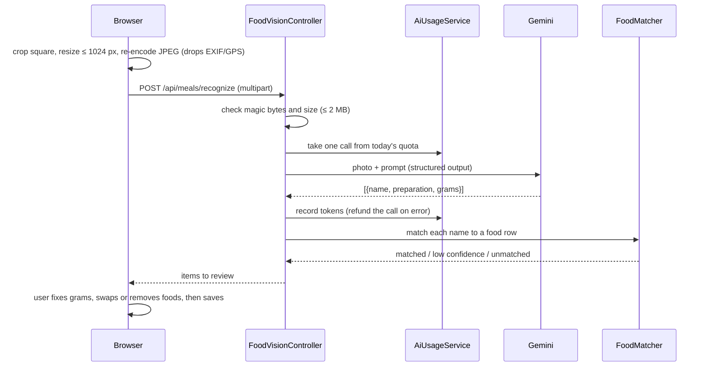

[MAIFit](../../README.md) / [Docs](../README.md) / [Modules](README.md) / Nutrition

# Nutrition

Meal logging with a food database, photo recognition, food search and requests for missing foods.

## The food table

Every number shown to the user comes from the `foods` table, never from a model. → [ADR 001](../decisions/001-ai-never-computes-calories.md)

- **Source:** USDA FoodData Central (SR Legacy and Foundation Foods, public domain), imported by scripts in `tools/usda-import/`. The scripts generate Flyway migrations; numbers are copied from the USDA files, never typed by hand.
- **One row per food and preparation** (`RAW`, `BOILED`, `STEAMED`, `FRIED`, `BRAISED`, `GRILLED`), all values per 100 g. About 330 rows in 8 groups.
- **Traceable:** each row stores its source item (`source_id`, `source_ref`) and the original USDA description. Rows estimated from a similar food say how they were computed; rows where USDA has no exact match are flagged as approximate.
- **Aliases** map everyday Vietnamese names to rows: "cơm trắng" → rice, boiled; "trứng ốp la" → egg, fried. Some aliases lock the preparation.
- **Lean and fat variants:** for cuts where USDA measures both "lean and fat" and "lean only", a slider interpolates between the two real measurements instead of inventing a fat ratio.

## Logging a meal

- A meal (`meal_logs`) has items (`meal_items`): a food row and grams.
- Calories and macros are **computed when read** (the [chatbot](chatbot.md#answering-a-question) uses the same code): `grams × value per 100 g`, in `NutritionCalculator`. The frontend uses the same formula and rounding for instant previews, so both always agree.
- Up to 10 meals per day and 30 items per meal.

## Photo recognition

- Each recognition uses one call of the [daily AI quota](premium.md#daily-quota).
- **The model only names foods and estimates grams.** It does not receive the food table (the prompt stays small as the table grows) and its calories are never used.
- **Matching** (`FoodMatcher`) uses trigram similarity on names and aliases, accent- and case-insensitive. Below 0.45 is unmatched; 0.45–0.75 is matched but flagged "check again", showing what the AI saw; above 0.75 is a confident match. The 0.75 line comes from a real miss: "canh chua" (sour soup) scores 0.60 against "cà chua" (tomato).
- **Prompt rules** handle known traps: split mixed dishes into ingredients, count only what is on the plate, edible part only, and never add cooking oil to an item that is already measured fried.
- The AI's original gram estimate is kept (`ai_grams`) to measure how far users correct it.

## Search and missing foods

- `GET /api/foods/search` returns up to 6 close names when the local filter finds nothing (word similarity, with and without accents).
- `POST /api/food-requests` records a missing food. Names are normalized so "Bún Mọc" and "bun moc" are one request; one vote per user per name; 5 new names per user per day. Unmatched names from photos are recorded automatically.
- Requests never carry nutrition values: a new food is added by a migration from a citable source.

## Food library

`/foods` lists every food with filters by group and source; `/foods/:name` shows each preparation, kcal per 100 g, energy split, a comparison between preparations and a link to the USDA item.

## Endpoints

| Method | Path | Notes |
|---|---|---|
| GET | `/api/foods`, `/api/foods/meta` | Food list, groups and sources |
| GET | `/api/foods/search?q=` | Close names |
| GET | `/api/foods/{id}/details` | Detail page |
| POST | `/api/food-requests` | Report a missing food |
| GET, POST, DELETE | `/api/meals`, `/api/meals/{id}` | Meals of a day |
| POST, PATCH, DELETE | `/api/meals/{id}/items/...` | Items |
| GET | `/api/meals/summary` | Daily totals |
| POST | `/api/meals/recognize` | Photo recognition (daily quota) |

## Trade-offs and limits

- **Ingredients, not dishes.** A bowl of phở is logged as noodles, beef and herbs. Accurate and traceable, but more items to review. A `dishes` table with default recipes is planned.
- **USDA has no Vietnamese-specific items** (some herbs, instant noodles, mixed dishes). The closest item is used and flagged; the Vietnamese food composition table is the next source to add.
- **Gram estimates from a photo are rough.** That is why the review screen is mandatory and every value is editable.
- **Trigram matching reads letters, not meaning.** "thịt kho tàu" does not find braised pork belly without an alias; semantic search with the chatbot's embeddings is planned.

---
<!-- nav -->

**Related:** [MBotFit chatbot](chatbot.md) · [Premium and AI quotas](premium.md) · [ADR 001: The AI never computes calories](../decisions/001-ai-never-computes-calories.md)

← [Auth](auth.md) | [Workout](workout.md) →
