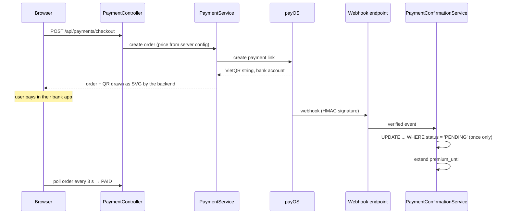

<sub>[MAIFit](../../README.md) / [Docs](../README.md) / [Modules](README.md) / Premium and AI quotas</sub>

# Premium and AI quotas

A paid plan that raises the daily AI limits, paid by bank transfer through payOS, plus the quota system that keeps AI cost bounded for every user.

## Plans

| | Free | Premium |
|---|---|---|
| Photo recognition per day | 3 | 10 |
| Chatbot questions per day | 2 | 5 |
| Price | – | 29,999 VND for 30 days |

Premium does not renew automatically; buying again while active adds 30 days to the current end date. Limits and price are configuration (`app.ai.daily-limit.*`, `PREMIUM_PRICE`), chosen from measured token cost.

## Daily quota

Every AI feature goes through `AiUsageService`:

```sql
INSERT INTO ai_usage (user_id, usage_date, feature, count) VALUES (?, ?, ?, 1)
ON CONFLICT (user_id, usage_date, feature)
DO UPDATE SET count = ai_usage.count + 1 WHERE ai_usage.count < :limit
```

- One statement, so two parallel requests can never both take the last call. Zero rows updated means the limit is reached.
- The call is taken **before** contacting the model and **refunded** if the model fails or times out.
- Requests refused in code (an invalid [image](nutrition.md#photo-recognition), a [medical question or nothing retrieved](chatbot.md#answering-a-question)) never reach this step and cost nothing.
- The day follows Vietnam time.
- Each call also records input and output tokens (output includes the model's "thinking", which Google bills as output). This is how the real cost per call was measured before setting prices: about 23 VND per photo and 32 VND per question.

## Checkout



- **The browser never grants Premium.** Only an event verified by the provider does: the webhook's HMAC signature, or a direct status check with payOS (`/refresh`) when the webhook is late or lost.
- **Idempotent.** The order moves from `PENDING` to `PAID` in one conditional `UPDATE`; a webhook delivered ten times extends Premium once. `premium_until` is extended in SQL with `greatest(premium_until, now()) + 30 days`, so two orders paid together do not overwrite each other.
- **Amount check.** The amount received must be at least the order amount stored on the server.
- **Strict CSP kept.** The QR code is drawn by the backend (ZXing → SVG); no payOS script or iframe is embedded.
- **Limits.** Orders expire after 15 minutes; at most 10 new orders per user per day; a pending order is reused if it still has at least 2 minutes.
- **Provider-agnostic.** `PaymentService` only knows the `PaymentProvider` interface (`createPayment`, `parseWebhook`, `fetchPayment`). payOS is one class; adding SePay means one new class.

## Frontend

Premium lives in the profile page: a Premium block in the header and a payment dialog with three states (waiting with QR and copy buttons, paid, expired). The logic is in `usePremiumCheckout` (create order, poll, manual check) so the dialog only renders state. Old `/premium` links redirect to the profile and open the dialog. The landing page reads public prices from `GET /api/payments/pricing`.

## Endpoints

| Method | Path | Notes |
|---|---|---|
| GET | `/api/payments/pricing` | Public |
| GET | `/api/payments/plan` | Current plan, limits, pending order |
| POST | `/api/payments/checkout` | No body: the price comes from the server |
| GET | `/api/payments/orders/{orderCode}` | Owner only, reads the database |
| POST | `/api/payments/orders/{orderCode}/refresh` | Asks payOS directly |
| POST | `/api/payments/webhook/payos` | Public, signature required |
| GET | `/api/ai/quota` | Remaining photo and chat calls |

## Trade-offs and limits

- **payOS has no sandbox.** Tests are real transfers, with a small local price.
- **No automatic renewal or refunds.** Simpler and safer for a one-person project; renewals are a manual purchase.
- **Webhook is not received locally.** The manual "I have paid" check calls payOS directly, which is also the fallback in production.

---
<!-- nav -->

**Related:** [MBotFit chatbot](chatbot.md) · [Nutrition](nutrition.md) · [Security](../security.md)

← [MBotFit chatbot](chatbot.md) | [Profile](profile.md) →
