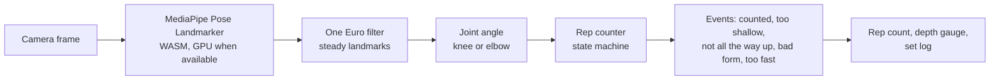
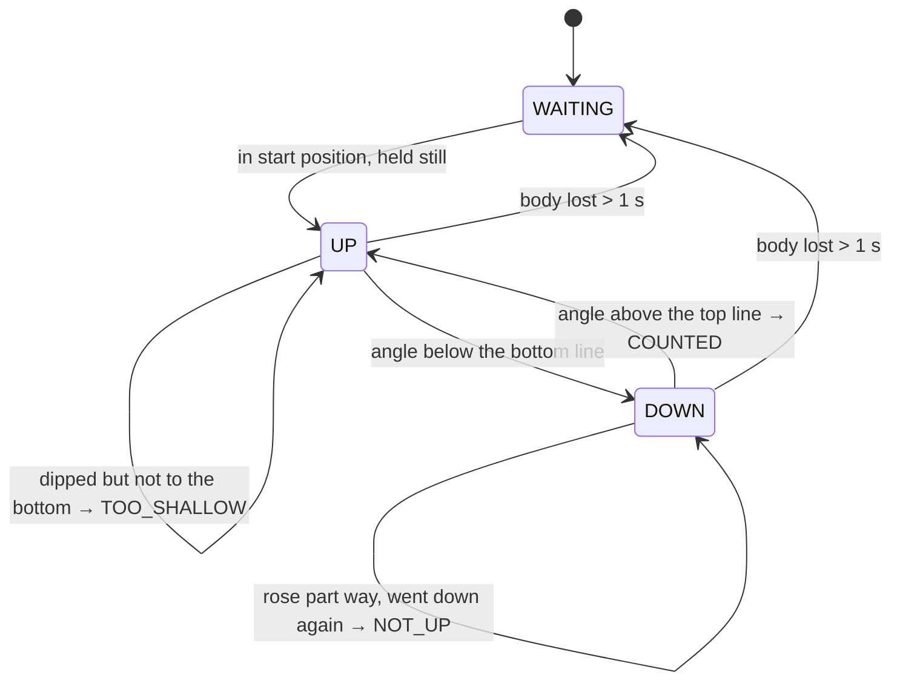

[MAIFit](../../README.md) / [Docs](../README.md) / [Modules](README.md) / Workout

# Workout

Rep counting with the camera, workout history, leaderboards, streaks and training time.

## Rep counting in the browser

The camera stream never leaves the device. → [ADR 002](../decisions/002-rep-counting-in-browser.md)

1. **Pose model.** MediaPipe Pose Landmarker (`full` model, `lite` on slow phones) returns 33 body landmarks per frame. Models and WASM files are served from the app's own origin, so the strict CSP stays intact; MediaPipe's telemetry call is blocked by that CSP on purpose.
2. **Smoothing.** A One Euro filter steadies landmarks when the body is still and follows quickly when it moves, so the skeleton does not shake and fast reps keep their bottom position.
3. **Set-up.** The user holds the start position still for a moment; counting starts only then. Losing the body for more than 1 s returns to waiting.
4. **Angle.** Squat uses hip–knee–ankle; push-up uses shoulder–elbow–wrist. The side the camera sees best is used.
5. **State machine** (`utils/pose/repCounter.ts`, pure and unit-tested), with hysteresis so noise around a threshold cannot count twice:

| Exercise | Bottom line | Top line |
|---|---|---|
| Squat (knee) | < 100° | > 150° |
| Push-up (elbow) | < 120° | > 150° |

- A half rep must cross 20° past a line to be reported, so small shakes stay silent.
- Two reps closer than 300 ms are jitter; the second one does not count.
- Form rules must fail for 3 frames in a row before they reject a rep. Examples: the knees bend but the hips do not drop (squat), the arms bend but the body does not go down (push-up), the body is not in a standing or plank position.
- **Every attempt is logged** in the set log with its depth and, when it did not count, the reason ("not all the way up: 132°"). Users learn from the misses instead of guessing.

## Saving a set

The browser sends `{exercise, reps, startedAt, durationSec, clientId}`. Because this data can be edited in DevTools, the server checks it again (see [Security](../security.md)):

- pace at most 3.5 reps per second (also a database `CHECK`);
- start time within the last 24 hours and not in the future;
- at most 20 sets and 2,000 reps per exercise per day;
- `clientId` is a UUID generated per set: a retried request on a flaky network is stored once (`UNIQUE (user_id, client_id)`).

## Leaderboards and streaks

- **Leaderboard:** one SQL query sums reps per user for one exercise and period (day, week, month) and ranks them with `RANK()`. It returns the top 20 plus the caller's own row, so "your rank" is known even outside the top. Only display names leave the database.
- **Periods use Vietnam time** (`Asia/Ho_Chi_Minh`); weeks start on Monday.
- **Streak:** consecutive days with at least one set, ending today, or yesterday if nothing was done yet today, so a streak is not "lost" in the morning.
- **Training time** (shown on the [profile](profile.md#training-time)): today, this week and this month, plus the last 7 days, 6 weeks and 6 months. SQL sums time per day; grouping into weeks and months is a pure function (`WorkoutTimeSummarizer`) with unit tests.

## Endpoints

| Method | Path | Notes |
|---|---|---|
| POST | `/api/workouts` | Save a set |
| GET | `/api/workouts` | Sets of a day |
| DELETE | `/api/workouts/{id}` | Owner only |
| GET | `/api/workouts/summary` | Week reps, streak |
| GET | `/api/workouts/time-summary` | Training time |
| GET | `/api/leaderboard` | `exercise`, `period` |

## Trade-offs and limits

- **The client can lie.** Counting on the device protects privacy and costs nothing on the server, but a determined user can post fake sets. Server checks bound what a cheater can gain; they do not prove a set happened.
- **2D pose from one camera.** Depth toward the camera is guessed by the model. Push-up hips and legs are drawn dashed because the model often guesses them; side or three-quarter views work best.
- **Two exercises.** Adding one means defining its joints, lines and form rules in `frontend/src/exercises/`, plus tests with recorded poses.
- **Leaderboard computed on every request.** Fine at this size; many users would need a cached or materialized result.

---
<!-- nav -->

**Related:** [Profile](profile.md) · [Security](../security.md) · [ADR 002: Count reps in the browser](../decisions/002-rep-counting-in-browser.md)

← [Nutrition](nutrition.md) | [MBotFit chatbot](chatbot.md) →
