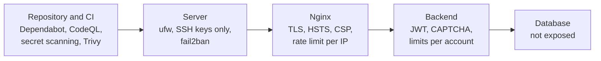

[MAIFit](../README.md) / [Docs](README.md) / Security

# Security

Each layer stops a different kind of attack, so getting past one is not enough. Verified externally: **Mozilla HTTP Observatory A+ (120/100)**.

z
## Threats and measures

| Threat | Measures |
|---|---|
| Stolen session | Access token in memory, 15 min; refresh token `HttpOnly` + `SameSite=Strict`, hashed in the database, rotated, reuse revokes every session → [ADR 006](decisions/006-token-storage.md) |
| Password guessing | Per-IP limit in Nginx; per-email lock after 5 failures in 15 minutes, checked before the password; fail2ban bans IPs that keep hitting limits |
| Account enumeration | Same error for wrong email and wrong password; `forgot-password` answers the same in every case |
| Bots and email abuse | Cloudflare Turnstile on register and password reset, verified on the server and failing closed; at most 3 reset emails per address per hour; 300 emails per day in total |
| Cross-site scripting | Strict CSP with no `unsafe-inline` or `unsafe-eval`; React escaping; chatbot answers rendered as plain text; only `http(s)` links |
| Clickjacking | `X-Frame-Options: DENY`, `frame-ancestors 'none'` |
| Accessing another user's data (IDOR) | Every query filters by the authenticated user; other users' resources return 404; ownership checked inside `DELETE` statements |
| Prompt injection | The model has no tools and no secrets; data is separated from instructions; outputs are validated by code; sources come from metadata → [chatbot](modules/chatbot.md) |
| Runaway AI cost | Per-user daily limit taken atomically before each call; refusals in code cost nothing; tokens recorded per call |
| Forged payments | Premium granted only from signed webhooks or a direct check with the provider; amount verified; idempotent update → [premium](modules/premium.md) |
| Cheating on reps | Server checks pace, time window, daily caps and duplicates; the client is not trusted |
| Photo privacy | Images re-encoded in the browser (EXIF and GPS removed); type checked by magic bytes; size capped |
| Leaked secrets | Secrets only in environment files and GitHub Secrets; secret scanning on pushes; the app refuses to start without required secrets |
| Vulnerable dependencies | Dependabot updates and alerts; Trivy blocks images with fixable critical CVEs; CodeQL static analysis |
| Exposed services | Firewall allows 22, 80, 443 only; containers bind to localhost or the internal network; database through an SSH tunnel |

## Headers

Set once in Nginx (`deploy/nginx/maifit.conf`): HSTS (1 year), Content-Security-Policy, `X-Content-Type-Options`, `Referrer-Policy`, `Permissions-Policy` (camera on this site only) and `X-Frame-Options`. The CSP was first deployed in report-only mode; the only violation was MediaPipe sending telemetry to Google, which is now blocked on purpose.

## Handling scanner findings

Findings are reviewed, not silenced. Each dismissed alert has a written reason. For example, CodeQL reports `` built from a file input as possible XSS; the value is always a `blob:` URL created by the browser, which cannot run script.

## Reporting a vulnerability

Please report security issues privately through GitHub's "Report a vulnerability" on this repository rather than in a public issue.

---
<!-- nav -->

**Related:** [Auth](modules/auth.md) · [MBotFit chatbot](modules/chatbot.md) · [Premium and AI quotas](modules/premium.md) · [Deployment](deployment.md)

← [Deployment](deployment.md) | [Roadmap](roadmap.md) →
